# Personalitify

> **Your life. Your rhythm. Your progress.**

[Türkçe](README.md) · **English**

[](https://github.com/efecrtgl/Personalitify/actions/workflows/ci.yml)
[](LICENSE)

Personalitify is a personal productivity and life-planning ecosystem that brings habits,
tasks, goals, the calendar, focus sessions, a journal and mood tracking together in one
place.

One central backend is designed to serve many clients: the React web application today; a
desktop application written in Rust and mobile clients later, on the same contracts.

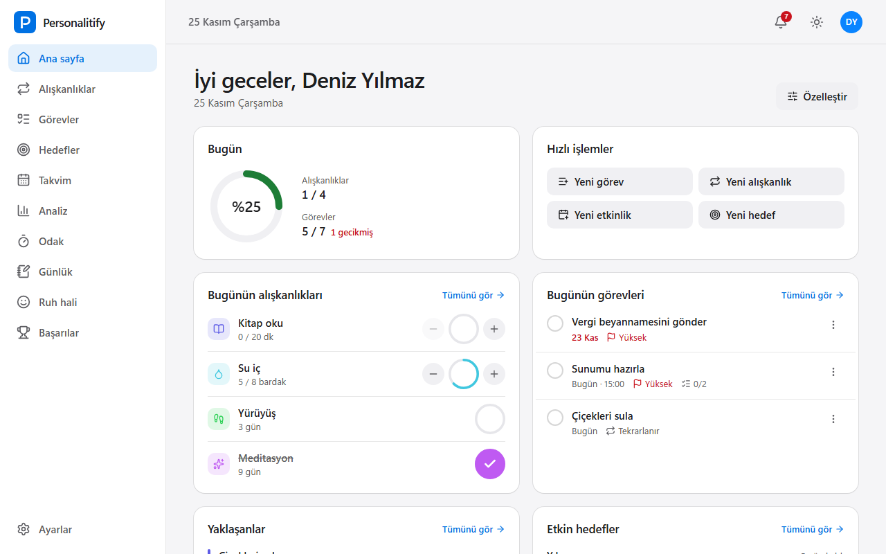

The interface is in Turkish by default and fully available in English; the screenshots show
the Turkish one.

## Contents

- [Features](#features)
- [Screenshots](#screenshots)
- [Quick start](#quick-start)
- [Scripts](#scripts)
- [Architecture](#architecture)
- [Documentation](#documentation)
- [Status and known limits](#status-and-known-limits)
- [Contributing and security](#contributing-and-security)
- [License](#license)

## Features

| Area                     | What is there                                                                                                                  |
| ------------------------ | ------------------------------------------------------------------------------------------------------------------------------ |
| **Habits**               | Daily, weekly or fixed-day schedules; yes/no, count and duration targets; streaks; archiving                                   |
| **Tasks**                | Priority, due date and time, subtasks, categories, recurring tasks, quick add                                                  |
| **Goals**                | Milestones, linked tasks and habits, progress                                                                                  |
| **Calendar**             | Month, week and day views; recurring events; tasks and habits on the same calendar                                             |
| **Dashboard**            | Today's summary, quick actions, weekly chart; widgets can be hidden and reordered                                              |
| **Analytics**            | Week, month, quarter and year; comparison with the previous period; rule-based highlights; CSV and print                       |
| **Focus**                | Focus and break sessions timed by the server; the time stays right when the tab is closed                                      |
| **Journal**              | Markdown, tags, pinning, search, revision history                                                                              |
| **Mood**                 | One entry a day, emotions, month view                                                                                          |
| **Achievements**         | Experience points, levels and 21 achievements, all computed from real records                                                  |
| **Notifications**        | Reminders, quiet hours, an in-app notification center                                                                          |
| **Account and security** | Email verification, password reset, session and device management, security log, data export, account deletion                 |
| **Realtime and sync**    | Open tabs and devices update at once over Socket.IO; a versioned, conflict-resolving sync protocol for offline-capable clients |
| **Interface**            | Turkish and English, light and dark themes, keyboard and screen-reader support, responsive from phone to wide screen           |
| **Administration**       | Release records and update checks, an announcement, opening and closing registration                                           |

There is no fake data in the application: every number, chart and achievement is computed
from the user's own records.

## Screenshots

Every picture was taken from the running application, with a sample account created
through the application's own API.

| Habits                                 | Tasks                                |
| -------------------------------------- | ------------------------------------ |
| 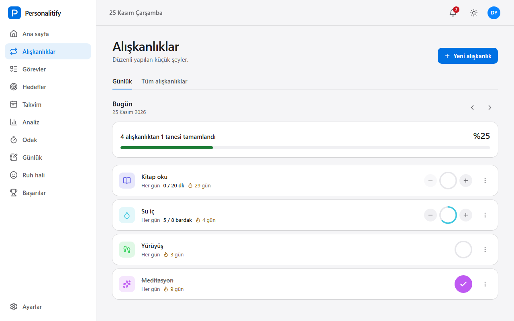 | 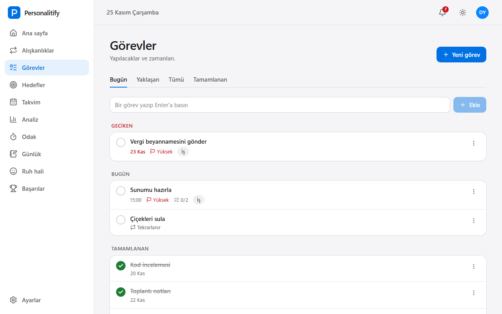 |

| Calendar                                   | Analytics                                    |
| ------------------------------------------ | -------------------------------------------- |
| 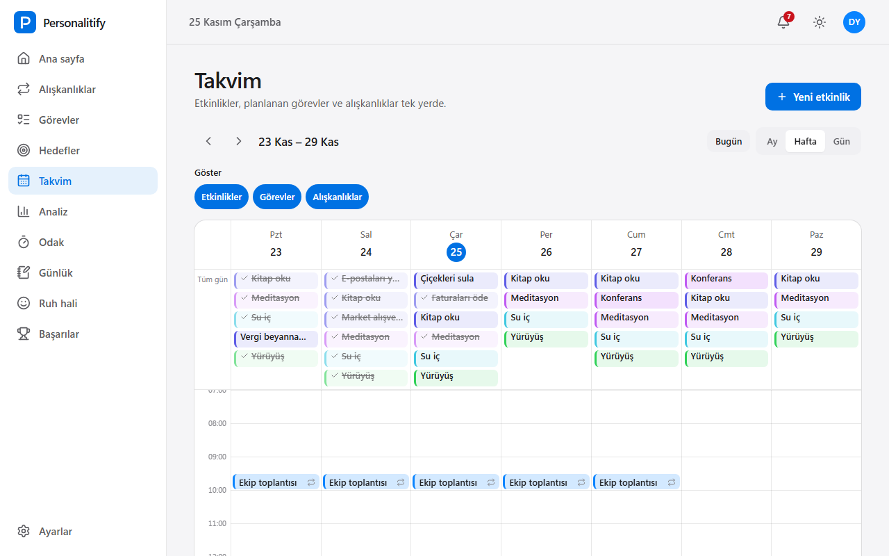 | 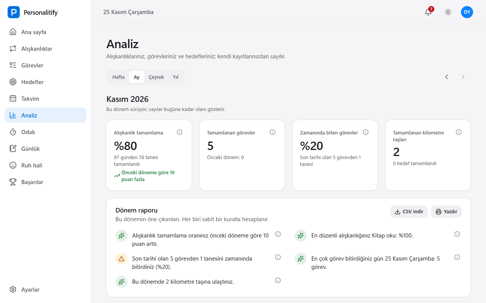 |

| Goals                                | Focus                                |
| ------------------------------------ | ------------------------------------ |
| 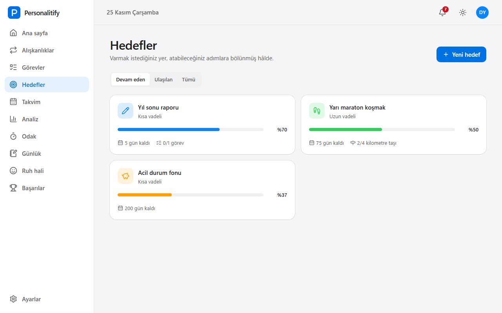 | 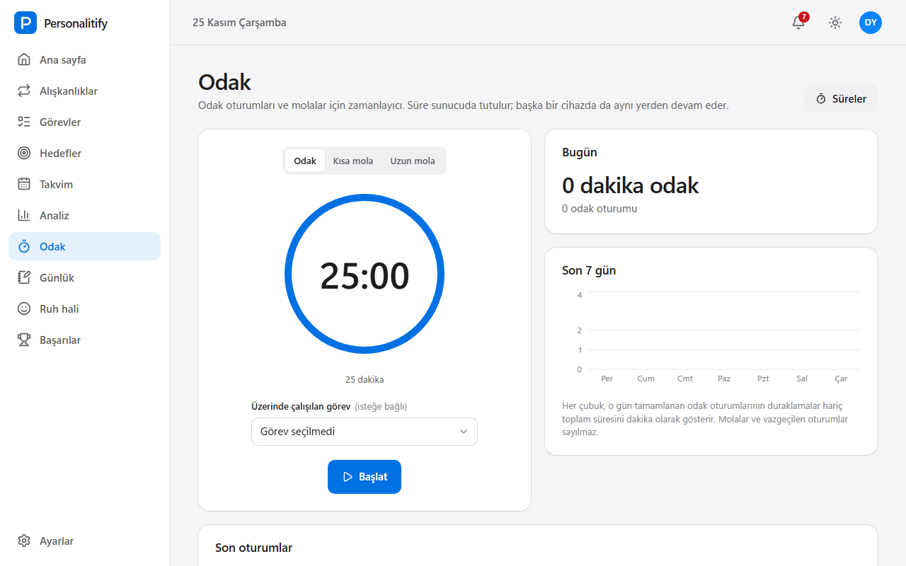 |

| Journal                                  | Mood                               |
| ---------------------------------------- | ---------------------------------- |
| 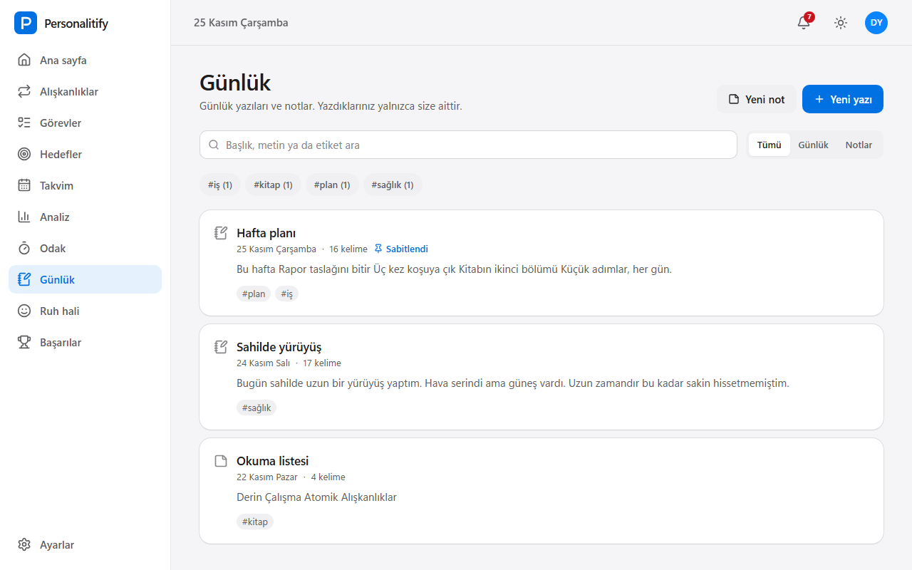 | 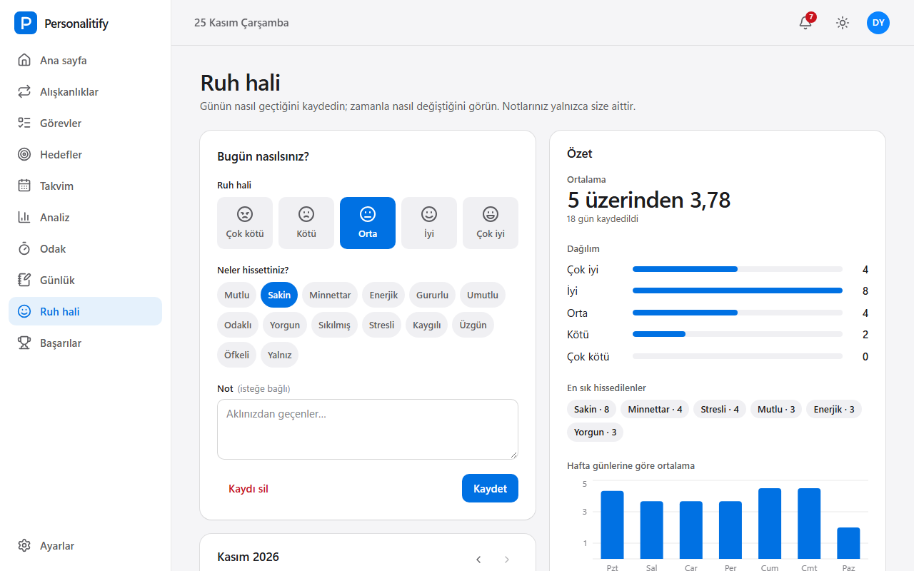 |

| Achievements                                       | Dark theme                                         |
| -------------------------------------------------- | -------------------------------------------------- |
| 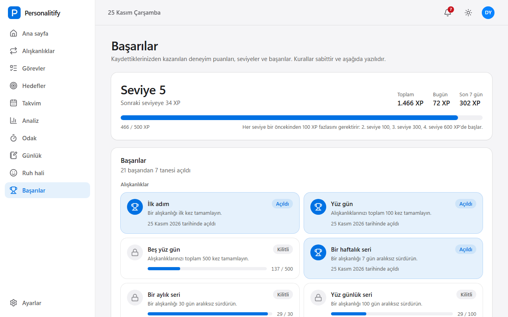 | 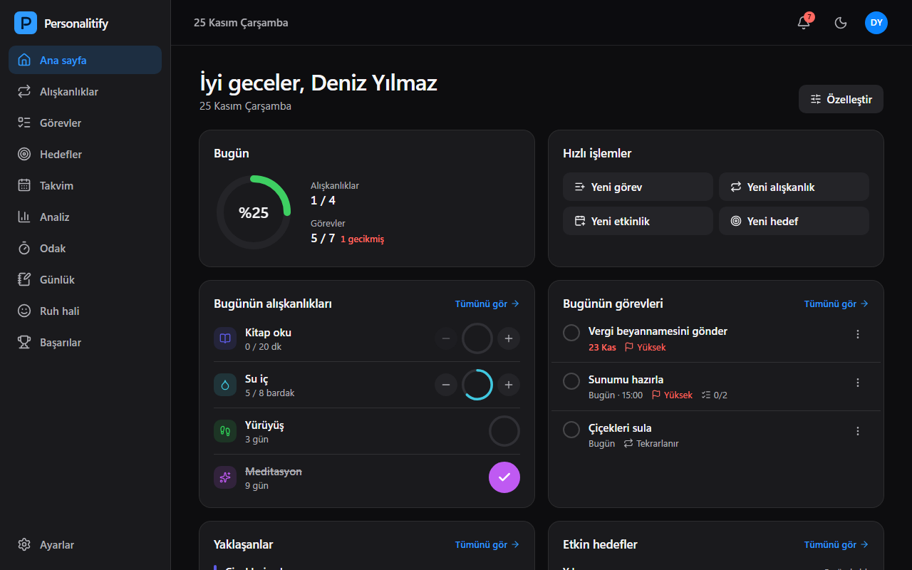 |

<p align="center">
  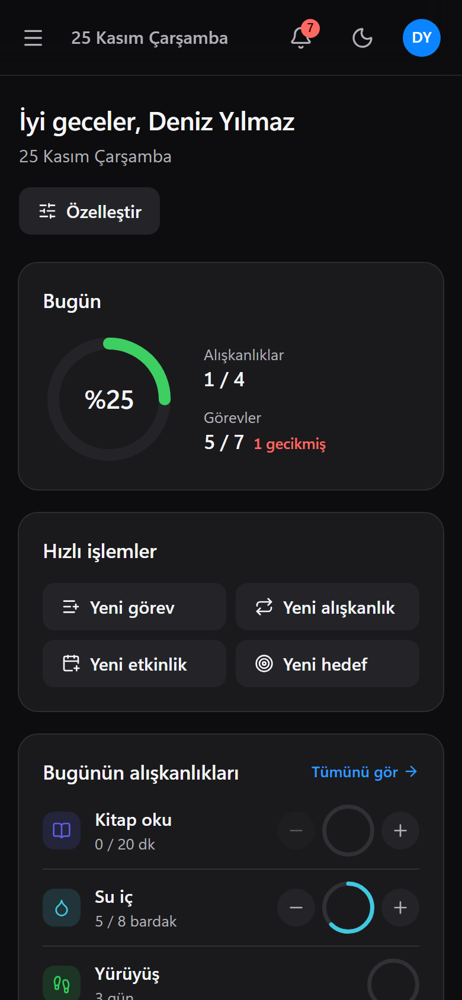
</p>

## Quick start

Requirements:

- **Node.js 22 LTS or 24**
- **MongoDB Community Server** (7 or newer), installed **and running**

Docker, Redis and paid services are not needed.

```bash
git clone https://github.com/efecrtgl/Personalitify.git
cd Personalitify
npm install
npm run dev
```

- Web application: <http://localhost:5173>
- API: <http://127.0.0.1:4000/api/v1>
- Interactive API reference: <http://127.0.0.1:4000/api/v1/docs>

On the first run `.env` is created from `.env.example` and a random signing secret is
generated for your machine. The database and its collections are created on first use. If
MongoDB is not running the API does not start and says why; it never falls back to a fake
database.

Without SMTP settings, verification and password-reset emails are not sent; during
development their content is written to the API's terminal output.

Details: [setup](docs/development/setup.md) ·
[troubleshooting](docs/development/troubleshooting.md)

## Scripts

| Command                                 | Purpose                                                  |
| --------------------------------------- | -------------------------------------------------------- |
| `npm run dev`                           | API and web client together, with reload                 |
| `npm run dev:api` / `npm run dev:web`   | Only one of them                                         |
| `npm run build`                         | Production build of the web client                       |
| `npm run start`                         | Run the API without file watching                        |
| `npm run test`                          | All tests (backend tests need MongoDB)                   |
| `npm run test:api` / `npm run test:web` | Tests of one package                                     |
| `npm run lint` · `npm run format:check` | ESLint and Prettier checks                               |
| `npm run docs:api`                      | Regenerate the OpenAPI document and the JSON Schemas     |
| `npm run admin:grant -- <email>`        | Give an account the admin role (`admin:revoke` takes it) |

## Architecture

```text
apps/
  api/        Node.js · Express · MongoDB (Mongoose) · Socket.IO — /api/v1
  web/        React · Vite · Tailwind CSS
  desktop/    Reserved for the future Rust client (documentation only)
packages/
  shared-contracts/   Constants and schemas shared by client and server
  localization/       Turkish and English texts
  api-client/         JavaScript client for the API, realtime and sync
docs/                 Architecture, API reference, setup, phase reports
```

- The whole project is **JavaScript** (ES modules).
- The backend is independent of the web client. Each of its 118 operations is defined with
  validation schemas; the [OpenAPI document](docs/api/openapi.json) and the
  [JSON Schemas](docs/api/schemas/) are generated from those definitions, and a test checks
  that they are current.
- Every change is written as a versioned record and an event; realtime delivery,
  notifications, achievements and synchronization all use the same event stream.
- Background jobs (reminders, focus timers, cleanup) need no separate service; they run
  inside the API process with locks kept in MongoDB.

More: [architecture overview](docs/architecture/overview.md) ·
[architecture decisions](docs/architecture/decisions.md)

## Documentation

Index of all documents: [docs/README.md](docs/README.md)

| Topic                  | Document                                                                                                    |
| ---------------------- | ----------------------------------------------------------------------------------------------------------- |
| Setup, troubleshooting | [setup](docs/development/setup.md) · [troubleshooting](docs/development/troubleshooting.md) (EN + TR)       |
| API                    | [overview](docs/api/overview.md) · [openapi.json](docs/api/openapi.json)                                    |
| Security               | [security](docs/architecture/security.md) · [SECURITY.md](SECURITY.md)                                      |
| Sync and events        | [synchronization](docs/architecture/synchronization.md) · [event-system](docs/architecture/event-system.md) |
| For the Rust client    | [rust-client-compatibility](docs/architecture/rust-client-compatibility.md)                                 |
| Roadmap, changes       | [roadmap](docs/roadmap.md) · [CHANGELOG](CHANGELOG.md) · [phase reports](docs/releases/)                    |

Setup and troubleshooting are written in English and Turkish; the architecture documents
are in English.

## Status and known limits

Version **0.1.0**: phases 0–17 of the roadmap are complete. The backend and the web client
work; the tests run on Node.js 22 and 24 on every push.

What should be said plainly:

- **There are no desktop (Rust) or mobile clients yet.** The backend contracts are ready
  and documented for them; the applications themselves have not been written.
- **The web client does not work offline.** The sync protocol exists on the server and in
  the JavaScript client; the web interface does not use it with a local store.
- **No push notifications.** Notifications are in-app; email is sent only for account
  actions, and only when SMTP is configured.
- **The update check only informs.** The server keeps release records and tells a client
  whether an update exists; there is no updater that downloads or installs files.
- **Designed for one process.** Rate limits are kept in process memory; several API
  instances would need a shared store.
- No end-to-end encryption, no second factor, no load test and no independent security
  audit. Details: [security](docs/architecture/security.md) ·
  [performance](docs/architecture/performance.md)

## Contributing and security

See [CONTRIBUTING.md](CONTRIBUTING.md) for the rules. If you find a vulnerability, please
follow [SECURITY.md](SECURITY.md) instead of opening a public issue.

## License

[Apache License 2.0](LICENSE)

Developed by **EfeCrtgl**
