# Personalitify

> **Hayatın. Ritmin. İlerlemen.**

**Türkçe** · [English](README.en.md)

[](https://github.com/efecrtgl/Personalitify/actions/workflows/ci.yml)
[](LICENSE)

Personalitify; alışkanlıkları, görevleri, hedefleri, takvimi, odak seanslarını, günlüğü ve
ruh hâlini tek bir yerde toplayan kişisel verimlilik ve yaşam planlama ekosistemidir.

Tek bir merkezî backend birden çok istemciye hizmet verecek şekilde tasarlanmıştır: bugün
React tabanlı web uygulaması; ileride aynı sözleşmeleri kullanacak, Rust ile yazılmış bir
masaüstü uygulaması ve mobil istemciler.

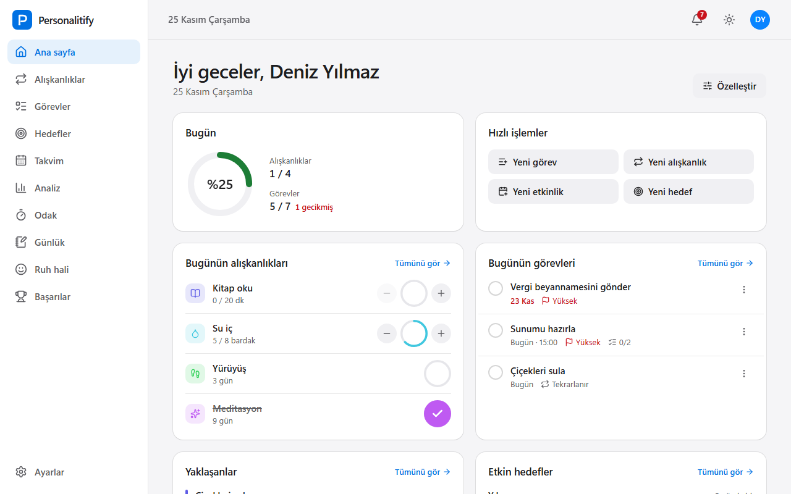

## İçindekiler

- [Özellikler](#özellikler)
- [Ekran görüntüleri](#ekran-görüntüleri)
- [Hızlı başlangıç](#hızlı-başlangıç)
- [Komutlar](#komutlar)
- [Mimari](#mimari)
- [Belgeler](#belgeler)
- [Durum ve bilinen sınırlar](#durum-ve-bilinen-sınırlar)
- [Katkı ve güvenlik](#katkı-ve-güvenlik)
- [Lisans](#lisans)

## Özellikler

| Alan                         | Neler var                                                                                                                              |
| ---------------------------- | -------------------------------------------------------------------------------------------------------------------------------------- |
| **Alışkanlıklar**            | Günlük, haftalık veya belirli günlere bağlı düzenler; evet/hayır, sayı ve süre hedefleri; seriler; arşivleme                           |
| **Görevler**                 | Öncelik, son tarih ve saat, alt görevler, kategoriler, yinelenen görevler, hızlı ekleme                                                |
| **Hedefler**                 | Kilometre taşları, bağlı görev ve alışkanlıklar, ilerleme                                                                              |
| **Takvim**                   | Ay, hafta ve gün görünümleri; yinelenen etkinlikler; görevler ve alışkanlıklar aynı takvimde                                           |
| **Ana sayfa**                | Günün özeti, hızlı işlemler, haftalık grafik; bileşenleri açıp kapatma ve sıralama                                                     |
| **Analiz**                   | Hafta, ay, çeyrek ve yıl; önceki dönemle karşılaştırma; kuralla hesaplanan öne çıkanlar; CSV ve yazdırma                               |
| **Odak**                     | Sunucu tarafında zamanlanan odak ve mola seansları; sekme kapansa da süre doğru kalır                                                  |
| **Günlük**                   | Markdown, etiketler, sabitleme, arama, sürüm geçmişi                                                                                   |
| **Ruh hâli**                 | Günde bir kayıt, duygular, aylık görünüm                                                                                               |
| **Başarılar**                | Deneyim puanı, seviyeler ve 21 başarı; hepsi gerçek kayıtlardan hesaplanır                                                             |
| **Bildirimler**              | Hatırlatmalar, sessiz saatler, uygulama içi bildirim merkezi                                                                           |
| **Hesap ve güvenlik**        | E-posta doğrulama, parola sıfırlama, oturum ve cihaz yönetimi, güvenlik günlüğü, veri dışa aktarma, hesap silme                        |
| **Gerçek zaman ve eşitleme** | Açık sekmeler ve cihazlar Socket.IO üzerinden anında güncellenir; çevrimdışı istemciler için sürümlü, çakışma çözen eşitleme protokolü |
| **Arayüz**                   | Türkçe ve İngilizce, açık ve koyu tema, klavye ve ekran okuyucu desteği, telefondan geniş ekrana duyarlı tasarım                       |
| **Yönetim**                  | Sürüm kayıtları ve güncelleme denetimi, duyuru, kaydı açıp kapatma                                                                     |

Uygulamada sahte veri yoktur: her sayı, grafik ve başarı kullanıcının kendi kayıtlarından
hesaplanır.

## Ekran görüntüleri

Görüntülerin tümü, çalışan uygulamadan ve uygulamanın kendi API'si üzerinden oluşturulmuş
bir örnek hesapla alınmıştır.

| Alışkanlıklar                                 | Görevler                                |
| --------------------------------------------- | --------------------------------------- |
| 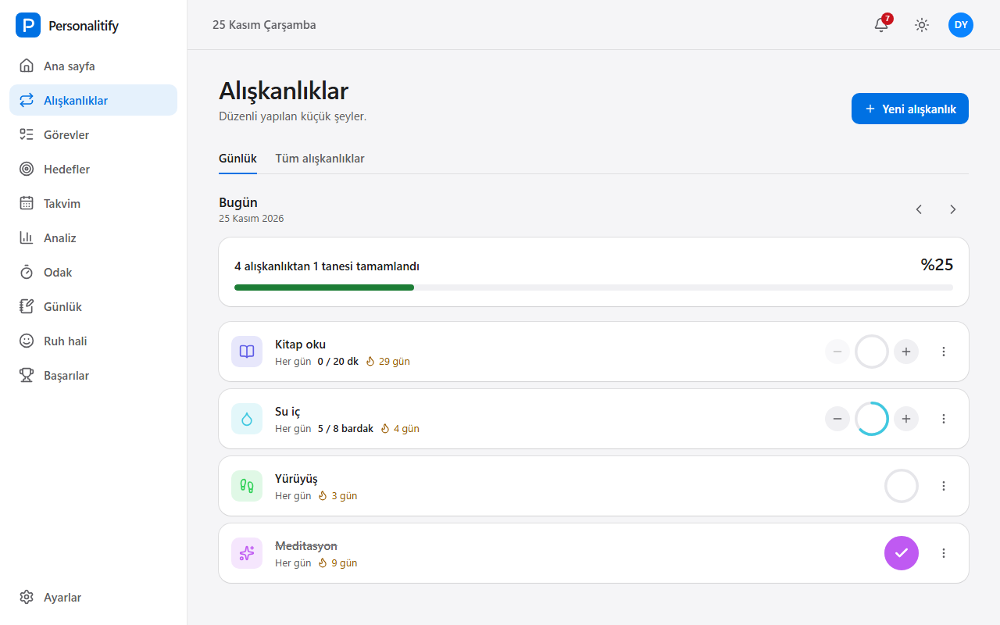 | 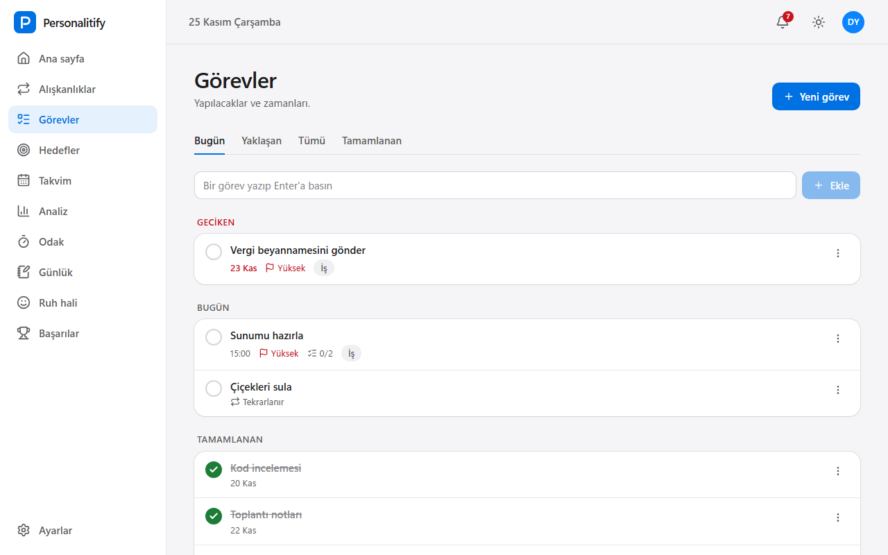 |

| Takvim                                   | Analiz                                    |
| ---------------------------------------- | ----------------------------------------- |
| 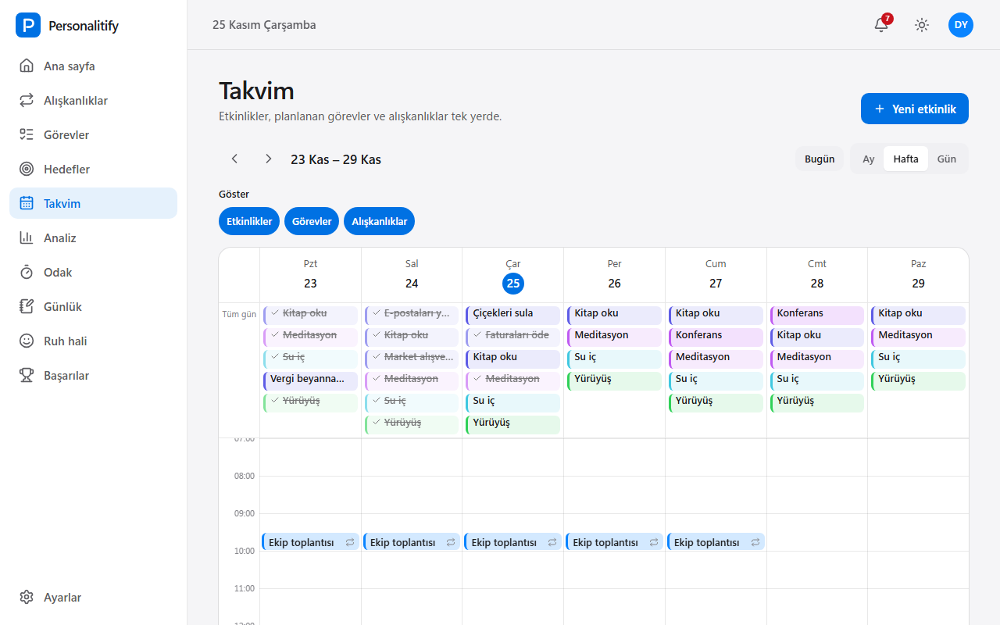 | 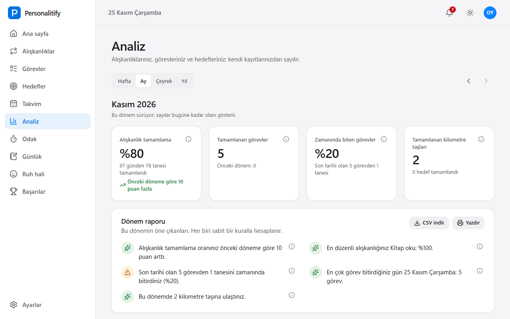 |

| Hedefler                                | Odak                                |
| --------------------------------------- | ----------------------------------- |
| 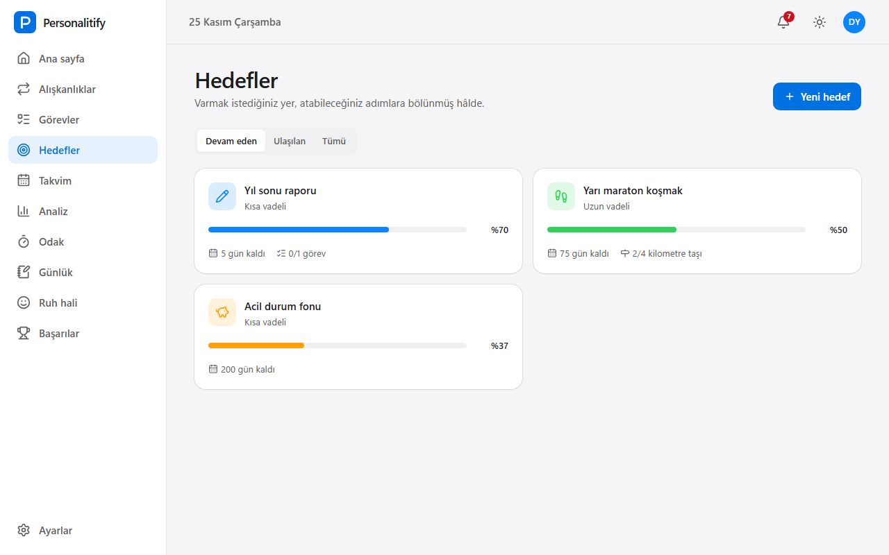 | 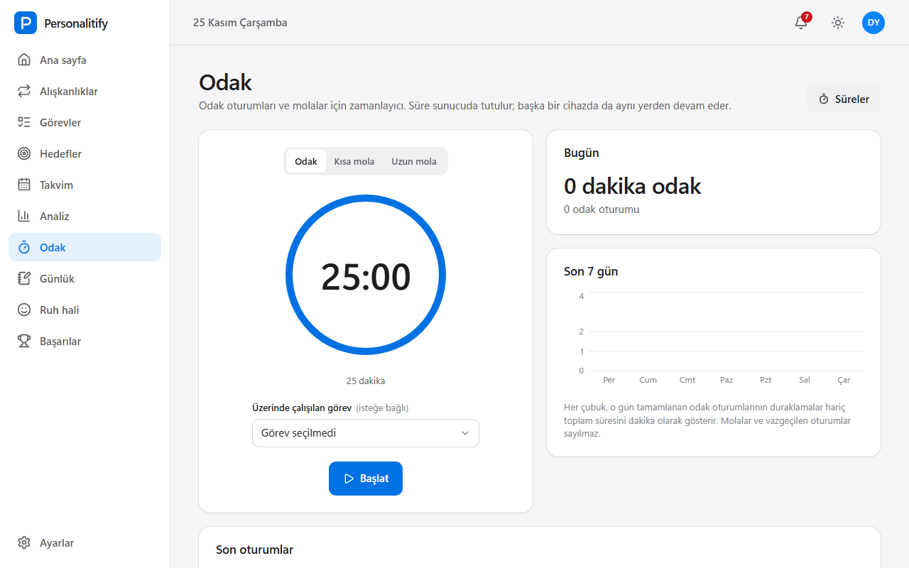 |

| Günlük                                  | Ruh hâli                               |
| --------------------------------------- | -------------------------------------- |
| 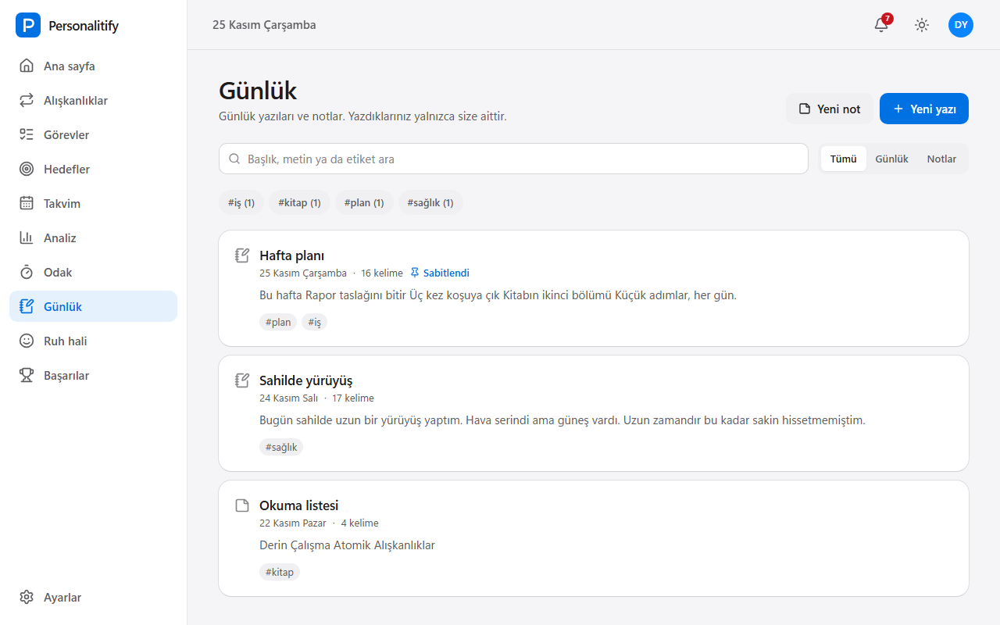 | 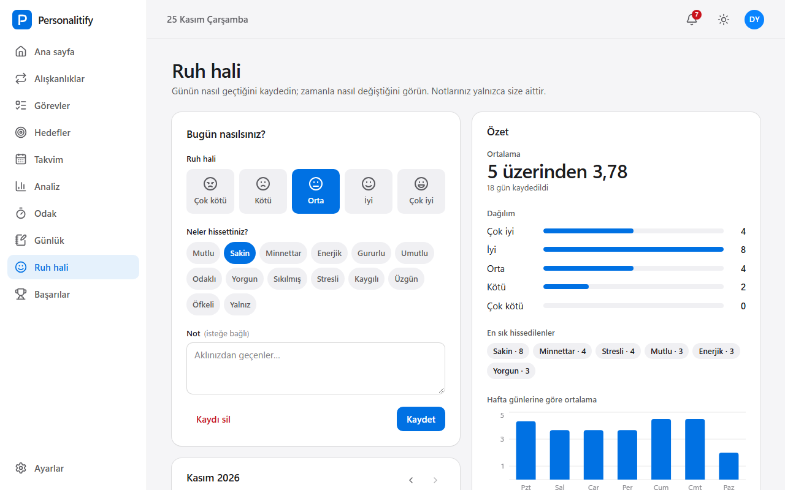 |

| Başarılar                                       | Koyu tema                                         |
| ----------------------------------------------- | ------------------------------------------------- |
| 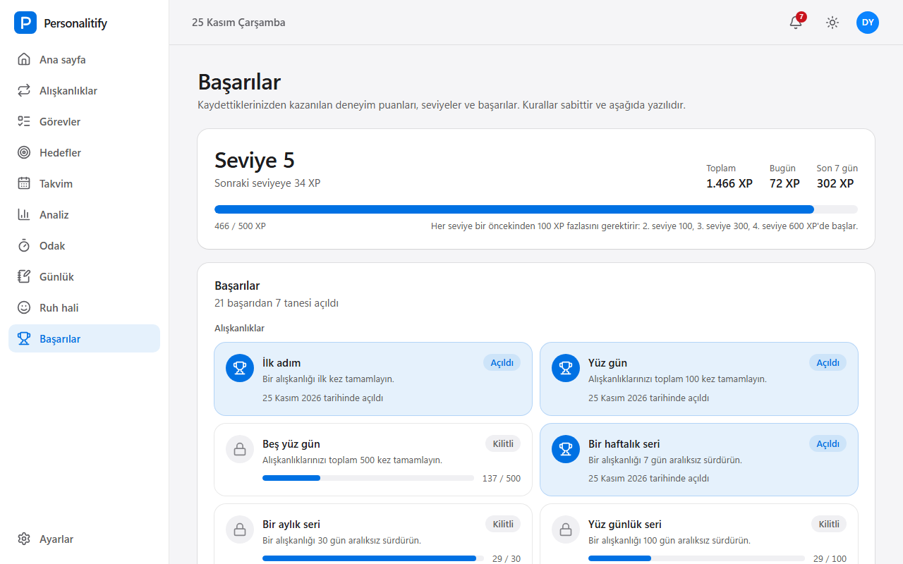 | 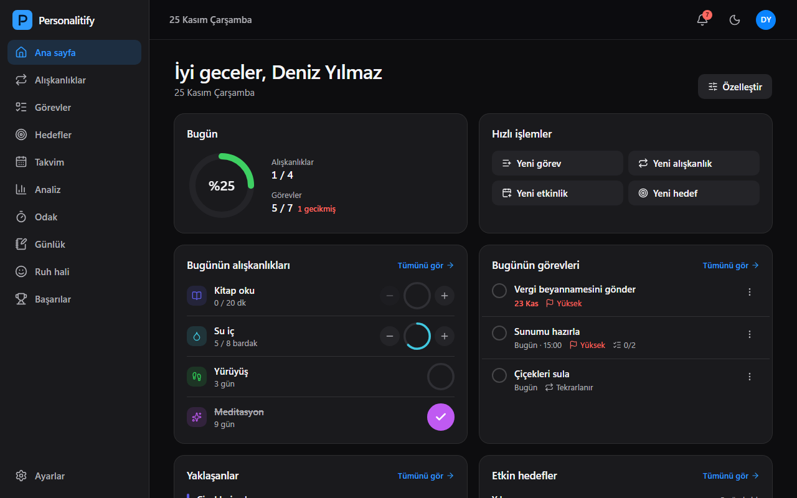 |

<p align="center">
  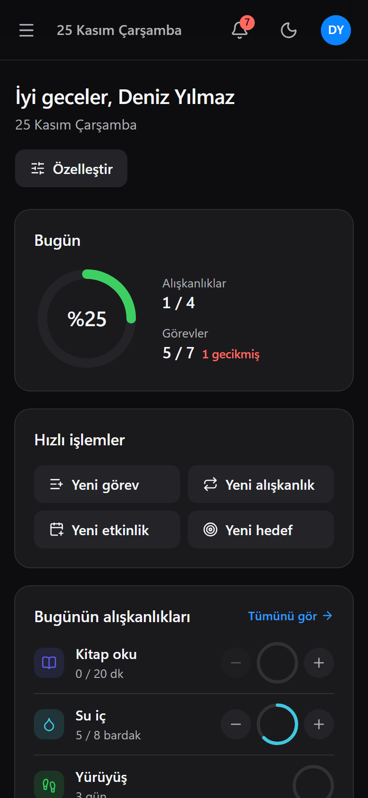
</p>

## Hızlı başlangıç

Gereksinimler:

- **Node.js 22 LTS veya 24**
- Kurulu ve **çalışır durumda** **MongoDB Community Server** (7 veya üzeri)

Docker, Redis veya ücretli bir servis gerekmez.

```bash
git clone https://github.com/efecrtgl/Personalitify.git
cd Personalitify
npm install
npm run dev
```

- Web uygulaması: <http://localhost:5173>
- API: <http://127.0.0.1:4000/api/v1>
- Etkileşimli API başvurusu: <http://127.0.0.1:4000/api/v1/docs>

İlk çalıştırmada `.env` dosyası `.env.example` üzerinden kendiliğinden oluşturulur ve
makinenize özel rastgele bir imzalama anahtarı üretilir. Veritabanı ve koleksiyonlar ilk
kullanımda oluşur. MongoDB çalışmıyorsa API başlamaz ve nedenini söyler; sahte bir
veritabanına geçmez.

SMTP ayarlanmadıysa doğrulama ve parola sıfırlama e-postaları gönderilmez; içerikleri
geliştirme sırasında API'nin terminal çıktısına yazılır.

Ayrıntılar: [kurulum](docs/development/setup.md) ·
[sorun giderme](docs/development/troubleshooting.md)

## Komutlar

| Komut                                   | Ne yapar                                                    |
| --------------------------------------- | ----------------------------------------------------------- |
| `npm run dev`                           | API ve web istemcisini birlikte, canlı yenilemeyle başlatır |
| `npm run dev:api` / `npm run dev:web`   | Yalnızca birini başlatır                                    |
| `npm run build`                         | Web istemcisinin üretim derlemesi                           |
| `npm run start`                         | API'yi dosya izleme olmadan çalıştırır                      |
| `npm run test`                          | Tüm testler (backend testleri MongoDB ister)                |
| `npm run test:api` / `npm run test:web` | Tek bir paketin testleri                                    |
| `npm run lint` · `npm run format:check` | ESLint ve Prettier denetimi                                 |
| `npm run docs:api`                      | OpenAPI belgesini ve JSON şemalarını yeniden üretir         |
| `npm run admin:grant -- <e-posta>`      | Bir hesaba yönetici rolü verir (`admin:revoke` geri alır)   |

## Mimari

```text
apps/
  api/        Node.js · Express · MongoDB (Mongoose) · Socket.IO — /api/v1
  web/        React · Vite · Tailwind CSS
  desktop/    Gelecekteki Rust istemcisi için ayrılmış yer (yalnızca belge)
packages/
  shared-contracts/   İstemci ve sunucunun paylaştığı sabitler ve şemalar
  localization/       Türkçe ve İngilizce metinler
  api-client/         API, gerçek zaman ve eşitleme için JavaScript istemcisi
docs/                 Mimari, API başvurusu, kurulum, aşama raporları
```

- Proje tümüyle **JavaScript** (ES modülleri) ile yazılmıştır.
- Backend, web istemcisinden bağımsızdır. 118 işlemin her biri doğrulama şemalarıyla
  tanımlanır; [OpenAPI belgesi](docs/api/openapi.json) ve
  [JSON şemaları](docs/api/schemas/) bu tanımlardan üretilir ve bir test güncel olduklarını
  denetler.
- Her değişiklik sürümlü bir kayıt ve bir olay olarak yazılır; gerçek zamanlı iletim,
  bildirimler, başarılar ve eşitleme aynı olay akışını kullanır.
- Arka plan işleri (hatırlatmalar, odak zamanlayıcıları, temizlik) ayrı bir servis
  gerektirmez; MongoDB üzerindeki kilitlerle API süreci içinde çalışır.

Daha fazlası: [mimariye genel bakış](docs/architecture/overview.md) ·
[mimari kararlar](docs/architecture/decisions.md)

## Belgeler

Tüm belgelerin dizini: [docs/README.md](docs/README.md)

| Konu                        | Belge                                                                                                       |
| --------------------------- | ----------------------------------------------------------------------------------------------------------- |
| Kurulum, sorun giderme      | [setup](docs/development/setup.md) · [troubleshooting](docs/development/troubleshooting.md) (TR + EN)       |
| API                         | [overview](docs/api/overview.md) · [openapi.json](docs/api/openapi.json)                                    |
| Güvenlik                    | [security](docs/architecture/security.md) · [SECURITY.md](SECURITY.md)                                      |
| Eşitleme ve olaylar         | [synchronization](docs/architecture/synchronization.md) · [event-system](docs/architecture/event-system.md) |
| Rust istemcisi için         | [rust-client-compatibility](docs/architecture/rust-client-compatibility.md)                                 |
| Yol haritası, değişiklikler | [roadmap](docs/roadmap.md) · [CHANGELOG](CHANGELOG.md) · [aşama raporları](docs/releases/)                  |

Kurulum ve sorun giderme belgeleri Türkçe ve İngilizcedir; mimari belgeleri İngilizcedir.

## Durum ve bilinen sınırlar

Sürüm **0.1.0**: yol haritasındaki 0–17. aşamaların tümü tamamlandı. Backend ve web
istemcisi çalışır durumdadır; testler her gönderimde Node.js 22 ve 24 üzerinde çalıştırılır.

Açıkça söylenmesi gerekenler:

- **Masaüstü (Rust) ve mobil istemciler henüz yok.** Backend sözleşmeleri onlar için
  hazırdır ve belgelenmiştir; uygulamaların kendisi yazılmadı.
- **Web istemcisi çevrimdışı çalışmaz.** Eşitleme protokolü sunucuda ve JavaScript
  istemcisinde vardır; web arayüzü bunu yerel bir depoyla kullanmaz.
- **Anlık (push) bildirim yok.** Bildirimler uygulama içindedir; e-posta yalnızca hesap
  işlemleri için ve SMTP ayarlandıysa gönderilir.
- **Güncelleme denetimi yalnızca bilgi verir.** Sunucu sürüm kayıtlarını tutar ve istemciye
  güncelleme olup olmadığını söyler; dosya indiren veya kuran bir güncelleyici yoktur.
- **Tek süreç için tasarlandı.** İstek sınırları süreç belleğinde tutulur; birden çok API
  kopyası için paylaşılan bir depo gerekir.
- Uçtan uca şifreleme, iki adımlı doğrulama, yük testi ve bağımsız güvenlik denetimi
  yapılmadı. Ayrıntılar: [güvenlik](docs/architecture/security.md) ·
  [performans](docs/architecture/performance.md)

## Katkı ve güvenlik

Katkı kuralları için [CONTRIBUTING.md](CONTRIBUTING.md) dosyasına bakın. Bir güvenlik açığı
bulduysanız lütfen herkese açık bir kayıt açmak yerine [SECURITY.md](SECURITY.md)
dosyasındaki yolu izleyin.

## Lisans

[Apache License 2.0](LICENSE)

Geliştirici: **EfeCrtgl**
