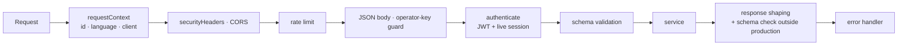
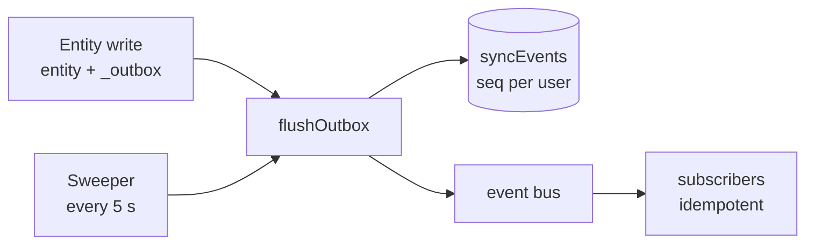

# Backend Architecture

The backend is a modular monolith in `apps/api`. It knows nothing about any particular
client; everything it offers is reachable through the documented HTTP and WebSocket contracts.

## Request lifecycle



| Step               | File                            | Notes                                                 |
| ------------------ | ------------------------------- | ----------------------------------------------------- |
| Request context    | `middleware/request-context.js` | `X-Request-Id`, `Accept-Language`, access log         |
| Security headers   | `middleware/security.js`        | Helmet, strict CSP, CORS allowlist                    |
| Rate limiting      | `middleware/rate-limit.js`      | 300/min general, 10/min on credential endpoints       |
| Input guard        | `middleware/security.js`        | Rejects `$operator` and dotted keys before any schema |
| Authentication     | `middleware/authenticate.js`    | Verifies the JWT and that its session is still live   |
| Validation/routing | `core/routing.js`               | zod schemas declared per route                        |
| Errors             | `middleware/error-handler.js`   | One exit point, stable codes, localized messages      |

## Declaring routes

Routes are declared with `createModule` from `core/routing.js`:

```js
const settings = createModule({ tag: 'Settings', basePath: '/settings' });

settings.patch(
  '',
  {
    summary: 'Update settings',
    body: updateSettingsBody, // zod schema
    response: settingsSchema, // zod schema
    errors: ['VALIDATION_FAILED', 'VERSION_CONFLICT'],
  },
  ({ auth, body }) => updateSettings(auth, body),
);
```

One declaration drives four things:

1. Input validation (`params`, `query`, `body`).
2. Authentication (`auth: 'user'` by default, `'none'` or `'admin'`).
3. The response envelope and status code.
4. The OpenAPI document (`core/openapi.js` reads the same registry).

Outside production every response is parsed against its declared schema, so a handler that
returns something the documentation does not describe fails the test suite. A further test
compares the committed `docs/api/openapi.json` with the generated document.

Handlers stay thin: parse nothing, decide nothing, call one service function.

## Module layout

```
modules/<name>/
  <name>.model.js      Mongoose schema, indexes, serializer
  <name>.schemas.js    zod request/response schemas
  <name>.service.js    domain logic
  <name>.routes.js     route declarations
```

Current modules: `health`, `auth`, `users`, `settings`, `devices`, `account`, `audit`,
`events`, `docs`.

## The entity service

Everything a user creates and that must reach their other devices is a **synchronized
entity**. `core/entity/entity-service.js` is the only write path for such entities.

```js
export const settingsService = createEntityService({
  entityType: 'settings',
  model: Settings,
  serialize: serializeSettings,
});
```

It guarantees, for every module that uses it:

- **Ownership.** Every read and write is filtered by `userId`. Another user's entity is
  indistinguishable from a missing one (404).
- **Versioning.** Each change increments `version`. Writes are conditional on the version
  that was read, so concurrent writers retry instead of overwriting each other.
- **Conflict handling.** `baseVersion` from the client is compared with the stored version.
  A stale change is merged when it touches different fields than the server-side changes
  since that version, otherwise it is rejected with `409 VERSION_CONFLICT` including the
  current resource and the conflicting field names.
- **Events.** The change and its domain event are one atomic single-document write (the
  event goes to the entity's `_outbox`). The relay moves it to `syncEvents`.
- **Tombstones.** Deletion sets `deletedAt` and emits `<entity>.deleted`.
- **No-op detection.** An update that changes nothing creates no version and no event.
- **Export and erasure.** The collection is registered for account export and deletion.

Domain operations that are more than a field patch use `service.mutate(context, id, fn)`,
which runs `fn` on the document inside the same guarded write.

## Events inside the process



- `modules/events/outbox-relay.js` relays pending events, assigns the per-user sequence
  number and dispatches to subscribers. It is idempotent: an event id is logged once no
  matter how often or how concurrently the relay runs.
- The sweeper picks up events whose relay did not complete (crash, database hiccup).
- `modules/events/event-bus.js` delivers logged events to in-process subscribers. Delivery
  is at-least-once and a failing subscriber never breaks the request.

## Authentication

| Item          | Design                                                                          |
| ------------- | ------------------------------------------------------------------------------- |
| Password hash | scrypt (N=2¹⁵, r=8, p=3), per-user salt, parameters stored with the hash        |
| Access token  | HS256 JWT, 15 minutes, claims `sub`, `sid`, `did`, `role`, `jti`                |
| Refresh token | 384 random bits, stored as SHA-256, rotated on every use                        |
| Reuse         | A rotated token presented again revokes the session (10 s grace for races)      |
| Revocation    | Session state is checked on every request, so it takes effect immediately       |
| Browser       | Refresh token in an `HttpOnly; SameSite=Strict` cookie scoped to `/api/v1/auth` |
| Native        | Refresh token in the response body                                              |
| Email tokens  | Single use, hashed, 48 h (verification) / 30 min (password reset)               |

Signing in again from the same installation replaces that installation's previous session.
A password reset signs out every session; a password change keeps only the current one.

## Errors

Services throw `AppError(status, code)` built with helpers from `core/errors.js`. The handler
adds the localized message (`errors:<code>` in `packages/localization`). Unknown errors are
logged with the request id and reported as `INTERNAL_ERROR` without internals.

## Configuration and logging

`config/env.js` validates the environment once at startup. `core/logger.js` is a pino logger
that redacts authorization headers, cookies, passwords and tokens.
