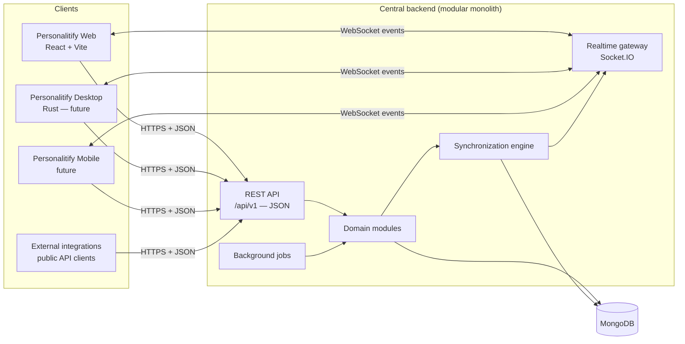
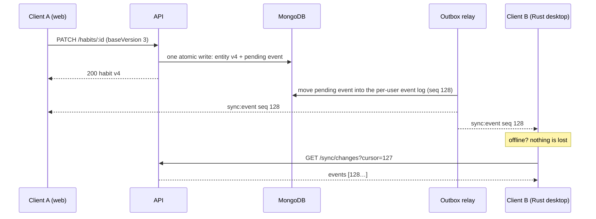

# Personalitify — Architecture Overview

> Status: living document. It describes the target architecture and is updated as phases land.
> Decisions and their rationale are recorded in [decisions.md](./decisions.md).

## 1. What Personalitify is

Personalitify is a personal life-management platform: habits, goals, tasks, calendar, focus,
journal, mood, achievements, notifications and analytics, served by **one central backend** to
**many clients**.



The backend is the single source of truth. No client holds business rules: a client renders
state, submits intents, and applies events. Everything a client needs is reachable through
documented HTTP/JSON and WebSocket contracts, so a Rust client is a peer of the web client, not
a second-class citizen.

## 2. Repository layout

```
Personalitify/
├─ apps/
│  ├─ api/                 Express + Mongoose + Socket.IO backend
│  ├─ web/                 React + Vite + Tailwind web client
│  └─ desktop/             Placeholder README for the future Rust client
├─ packages/
│  ├─ shared-contracts/    Event names, error codes, JSON Schemas, enums
│  ├─ api-client/          Framework-free JavaScript SDK for the API
│  └─ localization/        tr / en message catalogs shared by API and web
├─ docs/                   Architecture, API, development, release reports
├─ scripts/                Repository maintenance scripts
└─ .github/workflows/      CI
```

npm workspaces tie the packages together. Everything is JavaScript (ES modules); there is no
TypeScript anywhere in the repository.

## 3. Backend

A **modular monolith**: one deployable process, strict module boundaries inside it.

```
apps/api/src/
├─ config/        Environment loading and validation
├─ core/          Errors, HTTP helpers, route registry, entity service, time utilities
├─ database/      Connection management, shared schema plugins
├─ middleware/    Auth, validation, rate limiting, locale, request context
├─ modules/       One directory per domain module (see below)
├─ realtime/      Socket.IO gateway
├─ jobs/          In-process job runner and job definitions
├─ app.js         Express application factory (no network side effects)
└─ server.js      Process entry point
```

Each module owns its models, validation schemas, service (domain logic), controller-level route
definitions and domain events:

`auth` · `users` · `devices` · `settings` · `categories` · `habits` · `goals` · `tasks` ·
`calendar` · `dashboard` · `analytics` · `focus` · `journal` · `mood` · `achievements` ·
`notifications` · `synchronization` · `events` · `application-updates` · `feature-config`

Layering inside a module:

| Layer      | Responsibility                                                        |
| ---------- | --------------------------------------------------------------------- |
| routes     | HTTP surface, declared with schemas (also feeds the OpenAPI document) |
| service    | Domain rules, ownership, orchestration                                |
| model      | Mongoose schema, indexes, persistence-level validation                |
| schemas    | Request/response validation (zod)                                     |
| serializer | Shapes internal documents into public API resources                   |

Controllers are intentionally thin: a route definition parses input, calls one service function
and returns the shaped result.

### 3.1 API conventions

- Prefix: `/api/v1`. Breaking changes require a new prefix; additive changes do not.
- Media type: `application/json; charset=utf-8`.
- Success envelope: `{ "data": <resource | resource[]>, "meta": { ... } }`.
- Error envelope:
  `{ "error": { "code": "VALIDATION_FAILED", "message": "…", "details": [], "requestId": "…" } }`.
  `code` is a stable machine-readable identifier; `message` is localized (`Accept-Language`
  or the account language) and meant for humans only.
- Identifiers: UUID strings. Clients may supply the id when creating a resource, which makes
  offline creation and safe retries possible.
- Instants: ISO 8601 in UTC (`2026-11-24T16:00:00.000Z`).
  Calendar dates: `YYYY-MM-DD`. Times of day: `HH:mm`. Time zones: IANA names.
- List endpoints: `page`, `limit`, `sort`, plus module-specific filters;
  `meta` carries `page`, `limit`, `total`, `totalPages`.
- Concurrency: every synchronized resource carries an integer `version`. Updates send the
  version they were based on; a stale version yields `409 VERSION_CONFLICT` (see §5).
- Authentication: `Authorization: Bearer <access token>`.

### 3.2 Authentication

- Passwords are hashed with scrypt (Node.js `crypto`), per-user random salt, parameters stored
  with the hash so they can be raised later.
- Access tokens: short-lived signed JWTs (15 minutes) carrying user, session and device ids.
- Refresh tokens: opaque random values, stored only as SHA-256 hashes, rotated on every use.
  Reuse of an already-rotated token revokes the whole session.
- A **session** belongs to exactly one **device**. Sessions can be listed and revoked.
- Browser clients receive the refresh token as an `HttpOnly`, `SameSite=Strict` cookie scoped
  to the auth routes. Native clients receive it in the response body and store it in the
  operating system's secure storage. The same endpoints serve both.

## 4. Data

MongoDB via Mongoose. Local development targets a plain MongoDB Community Server (standalone,
no replica set, no Docker).

- Every user-owned document carries `userId`; every query in a service is scoped by it.
- Synchronized entities share a base shape: `_id` (UUID), `userId`, `version`, `createdAt`,
  `updatedAt`, `deletedAt` (tombstone) and an internal pending-event outbox.
- Documents are never returned raw. Serializers produce the public resource.
- Bounded embedding only (for example subtasks inside a task, capped). Anything that can grow
  without limit lives in its own collection.

Details: [database.md](./database.md) and [backend.md](./backend.md).

## 5. Events and synchronization

User-data synchronization is a first-class subsystem, not a by-product of the web client.



Core ideas:

1. **Atomic outbox without transactions.** An entity change and its domain event are written
   in a single document update (the event is appended to the entity's pending outbox). A relay
   then moves it to the `syncEvents` log idempotently. This holds on a standalone MongoDB,
   where multi-document transactions are unavailable.
2. **Per-user ordered log.** Every event gets a dense, per-user sequence number (`seq`). A
   client's position is a single integer cursor.
3. **Device-aware.** Devices register, authenticate, and acknowledge the cursor they have
   durably applied. The server tracks a cursor per device.
4. **WebSocket is an accelerator, never the source of truth.** Realtime messages only announce
   events that are already persisted. After any disconnection the client asks for
   `changes since cursor`.
5. **Idempotency.** Events have unique ids and entity versions; applying one twice is a no-op.
   Client mutations carry operation ids, so retries never double-apply.
6. **Conflict handling.** Optimistic concurrency per entity. When a mutation is based on a
   stale version the server attempts a field-level merge; overlapping fields produce an
   explicit conflict that is returned to the client together with the server state.
7. **Tombstones.** Deletions are soft: the record keeps its id and version so every device
   learns about the deletion.

Details: [synchronization.md](./synchronization.md) and [event-system.md](./event-system.md)
(written with Phases 12–13).

## 6. Application updates and remote configuration

Four concerns that are kept strictly apart:

| Concern              | What changes               | Mechanism                              |
| -------------------- | -------------------------- | -------------------------------------- |
| User data sync       | A user's records           | Event log, cursors, WebSocket          |
| Application updates  | The client binary / bundle | Release metadata + update manifest API |
| Remote configuration | Tunable values per client  | Versioned configuration documents      |
| Feature flags        | On/off switches per client | Targeted flag evaluation               |

The backend stores release metadata per application id (`personalitify-web`,
`personalitify-desktop`, `personalitify-mobile`), channel, platform and architecture. A native
client asks "is there a newer version for me?" and receives a manifest with download URL,
checksum, minimum supported version and whether the update is mandatory. The web client does
not receive binaries; it only learns that a newer bundle has been deployed.

## 7. Web client

React + Vite + Tailwind CSS, Lucide icons, Motion for animation, Recharts for charts.

- Talks to the backend only through `packages/api-client`.
- Server state lives in a query cache that is patched by synchronization events.
- All text comes from `packages/localization` (Turkish default, English second).
- Design system: tokens (color, type, spacing, radius, shadow), light/dark/system themes,
  reduced-motion support, accessible primitives.

Details: [frontend.md](./frontend.md).

Details: [frontend.md](./frontend.md).

## 8. Internationalization

One catalog per language and namespace under `packages/localization/locales/<lang>/<ns>.json`.
The web client loads them through i18next; the API uses the same catalogs for error messages,
notifications and emails. Adding a language means adding a directory — no code changes.

## 9. Time

Time is the hardest correctness problem in this product, so the rules are explicit:

- Instants are stored in UTC.
- "A day" always means a calendar day in the **user's configured IANA time zone**.
  Habit completions, streaks, daily statistics and reminders are keyed by local date
  (`YYYY-MM-DD`), never by a UTC date.
- Recurrence is computed on calendar dates, then projected to instants in the user's zone,
  which keeps schedules stable across daylight-saving transitions.

## 10. Quality

- Backend: unit tests for pure domain logic, integration tests against a real MongoDB test
  database through the HTTP surface.
- Web: component and flow tests in a DOM environment.
- CI: install, lint, test, build on every push and pull request.

See [../roadmap.md](../roadmap.md) for the delivery phases.
